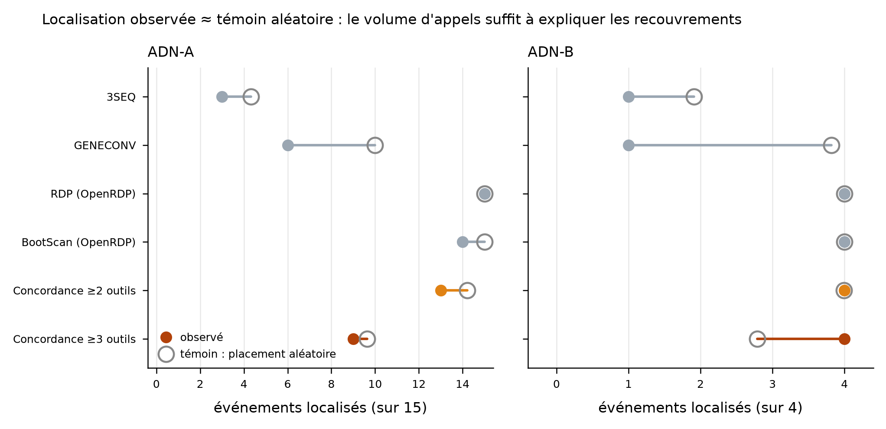

# Cassava validation set

This branch adds the empirical validation arm of vipan: cassava mosaic begomoviruses, whose
recombination events have been described in the literature, used to measure what the detectors and the
event-level concordance layer actually recover. The simulation bench (`benchmark/`) is the other arm, and
the one where the truth is exact.

Narrative report, in French: [`rapport_validation_manioc.fr.md`](rapport_validation_manioc.fr.md).

## Headline result

Every method flags 100 % of the published events, on both genome segments, in every configuration. That
number carries no information: 3SEQ calls all 120 DNA-A genomes recombinant.

Localisation looked better until it was given a control. RDP localises 15 published events out of 15 — while
emitting 26 219 intervals over 45 sequences. Keeping each method's call count and interval lengths and
redrawing their positions uniformly on the circular alignment, 200 times, shows that a method of that
volume localises just as many by chance:

| method (DNA-A, 45 genomes) | localised | expected under the control | calls |
|---|---|---|---|
| 3SEQ | 3 / 15 | 4.3 | 45 |
| GENECONV | 6 / 15 | 10.0 | 561 |
| RDP (OpenRDP) | 15 / 15 | 15.0 | 26 219 |
| BootScan (OpenRDP) | 14 / 15 | 15.0 | 44 460 |
| concordance ≥ 2 tools | 13 / 15 | 14.2 | 826 |
| concordance ≥ 3 tools | 9 / 15 | 9.6 | 166 |

Across the 19 scorable events and the four single methods — 76 combinations — four reach an empirical
p ≤ 0.05, all on DNA-A. And on the five DNA-A events whose two parental groups were both present in the
alignment, 3SEQ names a correct minor/major parent pair zero times.

What concordance buys is volume. Requiring three detectors to agree takes 71 343 calls down to 166 on
DNA-A and 39 312 to 94 on DNA-B, while the share of calls coinciding with a published event rises to
52.4 % and 46.8 %, against 45.0 % and 9.0 % for BootScan and 35.6 % and 6.0 % for RDP. That is 158 to 268
times fewer calls for a higher coincidence rate on both segments.



## State of OpenRDP (commit b42d9e5)

Three of the five Python methods do not complete on a 45-genome cassava alignment.

- **MaxChi** raises `IndexError: index 2886 is out of bounds` at `openrdp/maxchi.py:264`. The sliding
  window's `expand` move increments `right` without testing it against the number of scanned positions.
  [`openrdp_maxchi_bounds.patch`](openrdp_maxchi_bounds.patch) clamps both window edges; applying it moves
  the failure to `chi2_contingency`, which refuses a table with a zero expected frequency.
- **Chimaera** raises `ZeroDivisionError` at `chimaera.py:238`, on an empty `comp_seq`. Independently of
  the crash, the threshold on that line reads `0.05/len(comp_seq) - win_size` — a probability minus a
  window length.
- **SiScan** did not finish in 30 min on 30 genomes, nor in 2 h on 45. Both runs were interrupted.
- **RDP** writes values up to 13 704 in its `Pvalue` column, which cannot be a probability. OpenRDP's own
  source carries a `TODO` on this at `rdp.py:36`. `openrdp_to_events.py` keeps the reported number in the
  `note` column rather than thresholding it.

RDP and BootScan do complete, at 556 s and 2 103 s on a 45-genome alignment, against 1.5 s for 3SEQ.
OpenRDP's only parallel path is MPI, which does not initialise under a container without hwloc CPU
topology. As it stands, OpenRDP is not a drop-in replacement for RDP4.

## The truth table and its one serious caveat

`truth_cassava.tsv` holds 25 events — 16 on DNA-A, 9 on DNA-B — of which 19 are scorable. The bulk comes
from Table 1 of De Bruyn et al. 2012 (*BMC Evol Biol* 12:228, doi:10.1186/1471-2148-12-228), plus the
ACMBFV recombinant of Tiendrébéogo et al. 2012 (*Virol J* 9:67, doi:10.1186/1743-422X-9-67). Coordinates in
that table are expressed relative to JF909063.1 for DNA-A and JF909200.1 for DNA-B; the DNA-B reference is
stated outright in the paper for event B02, whose published bounds reproduce the table row exactly.

The caveat belongs in any manuscript using this table. All 24 De Bruyn events were called with RDP3 — with
the same seven methods tested here — and their breakpoints were manually checked and adjusted. Scoring
3SEQ or BootScan against this table does not measure their accuracy; it measures their ability to
reproduce a consensus they helped produce. A failure is informative, a success only half so.

The table is not exhaustive either. It lists what one 2012 study chose to report, not every event in a set
that now holds 974 DNA-A genomes. A call with no match in the table is therefore not a false positive, and
no precision figure is computed here — only a coincidence rate, which is a different quantity.

## Layout

```
cassava/            download, orient, align, thin, detect (3SEQ + GENECONV)
validation/
  *.py              truth projection, group assignment, concordance, scoring
  truth_cassava.tsv        the 25 events, with source and scorable flag
  truth_aligned_seg*.tsv   the same events projected onto alignment columns
  cassava_performance.tsv  one row per method x segment x dataset
  timings.tsv              measured runtimes, crashes and interruptions
  data/             frozen alignments, GenBank manifest, accession list
  events/           detector output in the common events.tsv format
  scores_*/         per-event and summary scoring tables
  figures/          the four figures of the validation
benchmark/          simulation bench v0 and its expected output
```

## Reproducing

MAFFT `--auto` is not deterministic on this kind of dataset: on the 465 sweepovirus genomes of the same
project the same FASTA gave 3 982 or 3 969 columns depending on the run. The whole truth projection rests
on column numbers, so **re-run the scoring on the committed alignments, not on a realigned set**.

```bash
# detection, on the frozen alignment
python cassava/detect_native.py --aln validation/data/cassava_segA_alignment_reduced.fasta \
    --out work/segA/detect
gunzip -k validation/events/events_openrdp_segA.tsv.gz

# event-level concordance, then scoring
python validation/concordance.py --events work/segA/detect/events.tsv \
    validation/events/events_openrdp_segA.tsv \
    --aln validation/data/cassava_segA_alignment_reduced.fasta --out work/segA/concordance/events.tsv
python validation/score_cassava.py --truth validation/truth_cassava.tsv \
    --truth-aligned validation/truth_aligned_segA.tsv --groups validation/groups_segA.tsv \
    --aln validation/data/cassava_segA_alignment_reduced.fasta --segment A \
    --events work/segA/detect/events.tsv validation/events/events_openrdp_segA.tsv \
            work/segA/concordance/events.tsv --out-dir work/scores
```

Rebuilding the input set from GenBank: `cassava/run_cassava.sh A` re-runs the search, which returns more
records as GenBank grows. `validation/data/accessions.txt` pins the 1 842 records actually used. Accessions
are immutable, so fetching that list reproduces the exact input; re-running the search does not.

The 3SEQ and GENECONV binaries are not committed. They ship with OpenRDP under an academic /
non-commercial licence that does not allow redistribution — `benchmark/setup.sh` clones OpenRDP at the
pinned commit and uses them from there.

## Metrics, as fixed before looking at results

- **flagged** — at least one significant call (p < 0.05) names a member of the event's recombinant group.
  3SEQ names a child; GENECONV only names a pair, so either member counts.
- **localised** — flagged, and the reported interval reaches a circular Jaccard index of at least 0.3 with
  the published interval.
- **parents ok** — among localised 3SEQ calls, at least one reports two parents falling in the published
  minor and major parent groups, in either order. Scored only where both groups are named and present.
- **random-placement control** — added after seeing RDP localise 15/15 on 26 219 calls, then applied
  uniformly to every method including concordance. Keeps each method's call count and interval lengths,
  redraws positions uniformly on the circular alignment, 200 replicates, seed 20261009.

Group membership is resolved from the GenBank organism field (`make_keep_list.py`); two isolate-level
groups of the truth table that no organism name can express — the two Seychelles DNA-B sequences and
JF909211.1 — are listed explicitly in that script.
